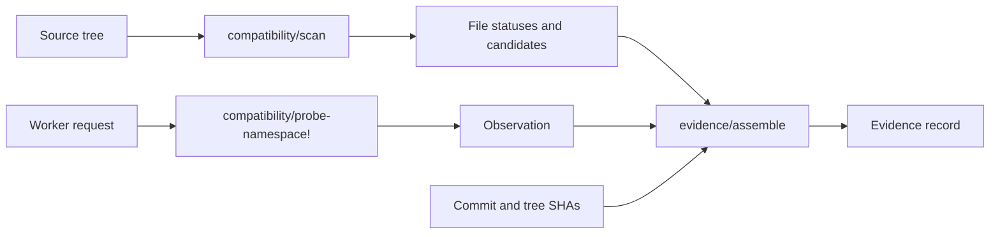

# Evidence record

This document states the model for the experimental evidence adapter. It does
not admit a build to production.

## Objects

- A **source tree** is a Git commit SHA, the tree SHA of that commit, and one
  digest per `.cljs`/`.cljc` file.
- A **candidate** is a `candidate-v2` discovery: path, source digest, operator,
  edit, position, and fingerprint.
- An **observation** is one worker result. Its role is `:baseline` or
  `:mutation`. It carries counters, a status, runtime provenance, and the
  worker's own `:qualification-eligible?` flag.
- An **evidence record** is the value of `heretic.cljs.evidence/assemble`.

## Morphisms

`scan` reads files and does not execute them. `probe-namespace!` runs one fresh
worker and copies that worker's eligibility flag. `assemble` only sorts and
classifies data it is given.

## Laws

- The same inputs produce the same EDN. Printing ignores the caller's
  `*print-length*`, `*print-level*`, `*print-readably*`, and `*print-dup*`.
- `:production-admitted?` is false on every record. This adapter does not
  implement Axxium Services admission, the 250-kill batch rule, or a restored
  baseline receipt.
- `:qualification-eligible?` is true only when `:heretic.cljs/eligibility-v1`
  holds. The failed predicate names are in `:eligibility`.
- The nbb worker has no rule that sets its own flag to true. A record assembled
  from worker observations therefore fails `:worker-ineligible`.

### eligibility-v1

All of the following are required:

- commit SHA and tree SHA are 40 lowercase hex characters
- every file status is `:ok`, with a 64-hex source digest, and there is at least one file
- candidate fingerprints are unique and non-empty
- exactly one `:baseline` observation, status `:survived`, with positive test and assertion counts and no failures or errors
- at least one `:mutation` observation, each `:survived` or `:assertion-killed`, with counters matching that status, and a fingerprint present in the candidate set
- every observation has worker-reported runtime availability `:observed`
- every observation's own `:qualification-eligible?` is true

A caller can construct inputs that meet the rule. The worker cannot, because it
always records false.
